# macOS Modern Theme

## Ventura

Added Ventura Versions + Icons!

---

macOS Modern is a set of Visual Studio Code themes styled to match native macOS as closely as possible.  Updated to include dark + light versions and icon + product icon themes. Reapply both icon and color themes if you have problems. See the settings below for the rounded UI and optional macOS glass effect.

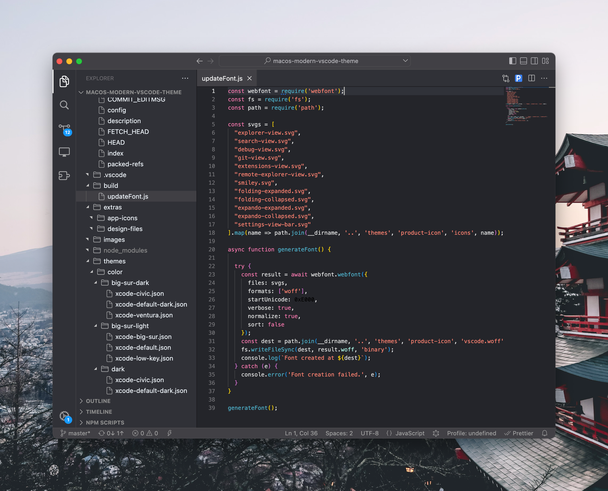

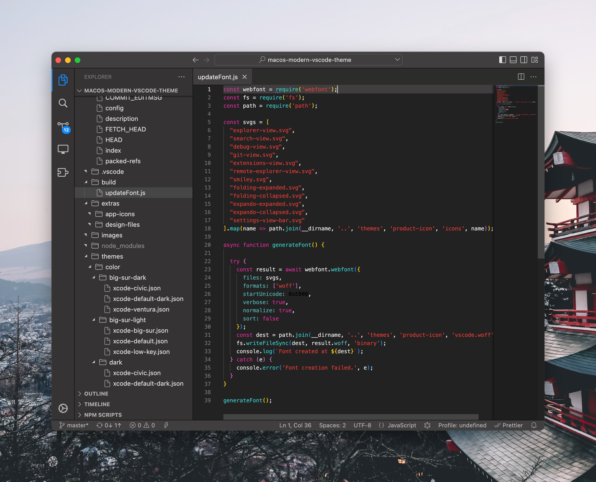

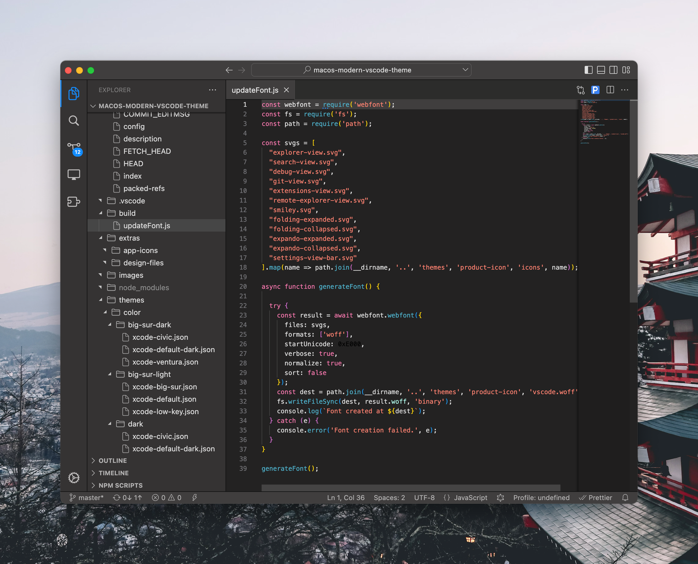

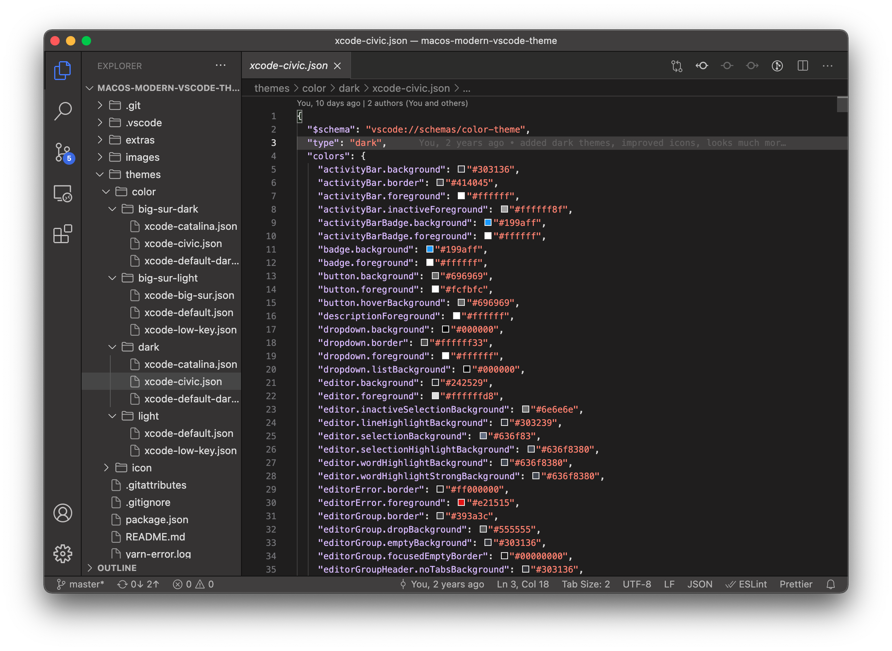

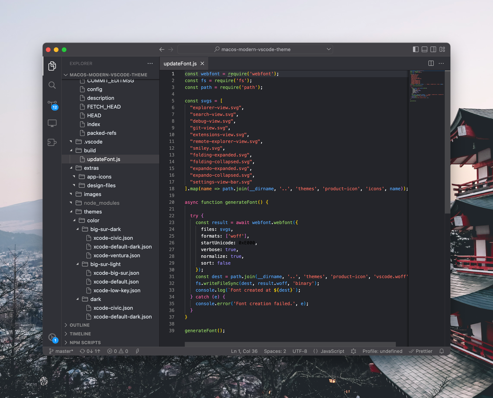

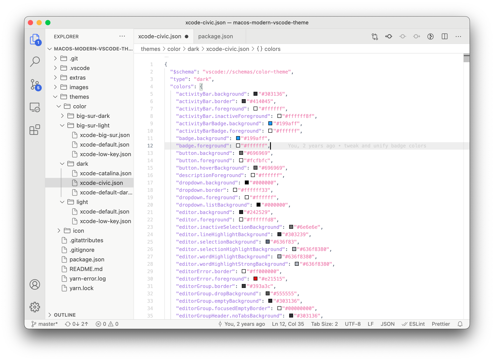

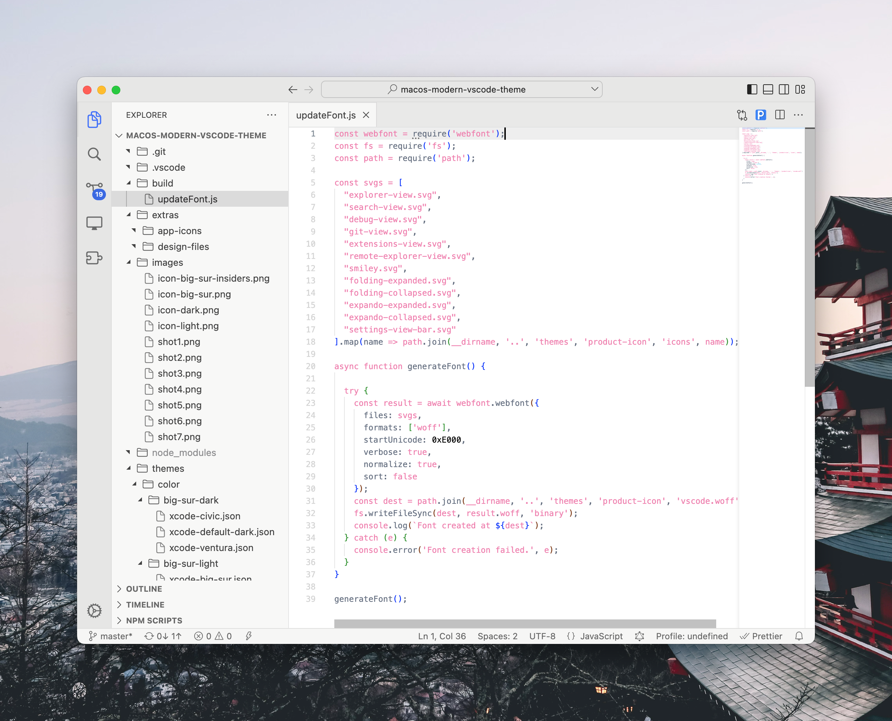

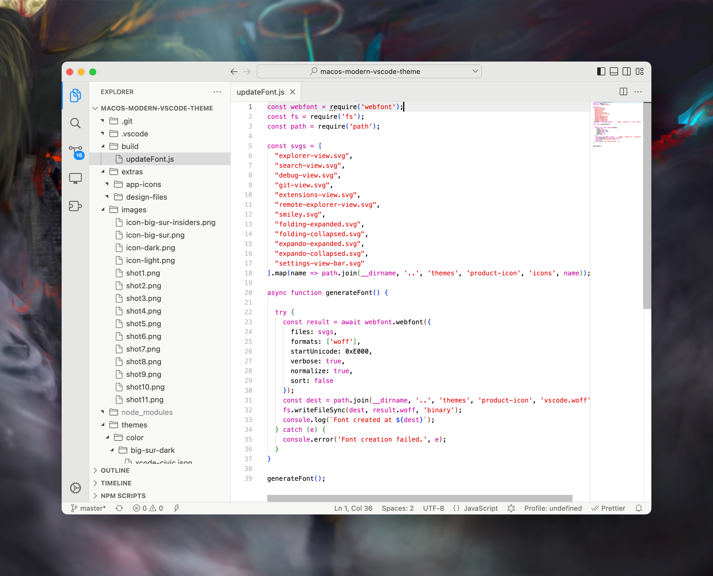

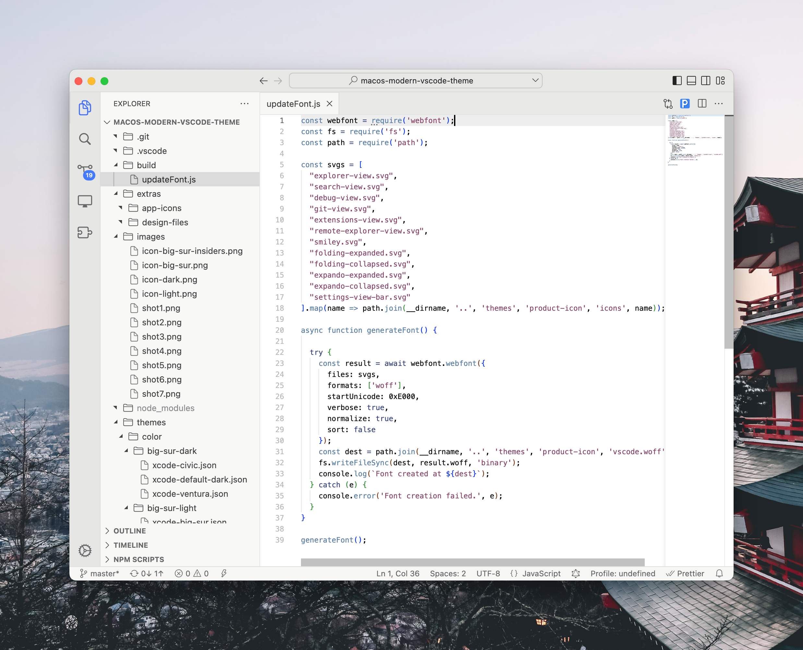


---

## Setup & Tweaks

The themes support VS Code's rounded Modern UI, with coordinated card surfaces, connected or pill tabs, subtle borders, and blue navigation accents. Light and dark variants retain their existing syntax palettes and opaque editor backgrounds. The appearance takes inspiration from macOS Liquid Glass; transparency and blur are rendered by VS Code, rather than by the theme.

### Rounded UI

Merge these settings into your User Settings on a VS Code build that supports Modern UI:

```jsonc
{
  "workbench.experimental.modernUI": true,
  "window.density.layout": "default",
  "workbench.experimental.modernUIEditorTabStyle": "pill"
}
```

Keep layout density at `default` to retain the floating cards, gaps, and rounded corners. Use `pill` for separate rounded editor tabs with a soft selected fill and no continuous tab underline. Choose `connected` if you prefer tabs joined to the editor surface. The tab shape is a VS Code setting and is not changed by installing a color theme. These settings are experimental and may change between VS Code releases. The themes also include classic UI colors for builds without the new appearance.

Select your preferred color variant with **Preferences: Color Theme**. The Ventura icon set can be selected separately with **Preferences: File Icon Theme**.

### Optional glass effect on macOS

On macOS builds with VS Code's frosted-glass support, these settings let VS Code render translucent window surfaces:

```jsonc
{
  "workbench.modernUIFrostedGlass": true,
  "workbench.modernUIFrostedGlassOpacity": 80
}
```

Higher opacity gives a more tinted, solid appearance. The effect depends on your VS Code version and macOS accessibility settings; Reduce Transparency can disable it. The theme's editor backgrounds remain opaque for readability. This is VS Code's glass effect, rather than Apple's native Liquid Glass material.

### Optional macOS preferences

```jsonc
{
  "editor.fontSize": 12,
  "editor.fontFamily": "SF Mono, Monaco, monospace",
  "editor.tabSize": 2,
  "editor.fontWeight": "normal",
  "window.titleBarStyle": "native",
  "window.nativeTabs": true,
  "workbench.editor.showIcons": false,
  "editor.minimap.enabled": false
}
```

Native window title bars and macOS window tabs are controlled by the operating system, so their appearance can differ from the themed editor tabs. Font and zoom preferences are optional; the theme does not depend on a particular font or zoom level.

You can move the Activity Bar to the top of the sidebar with `"workbench.activityBar.location": "top"`, or hide it with `"workbench.activityBar.location": "hidden"`.

### Activity Bar badge background

Choose one badge color in `workbench.colorCustomizations`:

```jsonc
{
  "workbench.colorCustomizations": {
    "activityBarBadge.background": "#007aff" // Use #ff453a for red.
  }
}
```

### Previewing local changes

Open this repository in VS Code and press **F5**, using **Preview macOS Modern Theme**. The Extension Development Host loads this folder as an extension and uses a separate profile and extensions directory under `.vscode-test`, leaving your usual settings and installed extensions alone. No build step is required.

In the preview window, select a **MacOS Modern** color theme. Enable the rounded UI settings above if your preview profile does not already have them. Check light and dark variants, multiple editor groups, active and hovered tabs, sidebar selections, the bottom panel, and keyboard focus. Switch between `connected` and `pill` tab styles to review both appearances.

The modern surface and tab color names follow the [VS Code theme color reference](https://code.visualstudio.com/api/references/theme-color#modern-ui-colors). Layout and tab behavior are described in [VS Code's Modern UI theming guide](https://github.com/microsoft/vscode/blob/main/src/vs/workbench/contrib/modernUI/README.md).

---

## Extras

Light and dark VSCode icons are also included in full quality (don't use the small preview below) on the GitHub repo or in the extension folder in:
`~/.vscode/extensions/davidbwaters.macOS-modern-theme/extras/app-icons`
You could also download the files from the repo [folder](https://github.com/davidbwaters/macOS-modern-vscode-theme/tree/master/extras) by clicking the name of the `icns` or `png` and clicking the "Download" button. You can use the free app [LiteIcon](https://freemacsoft.net/liteicon/) to change the icon.

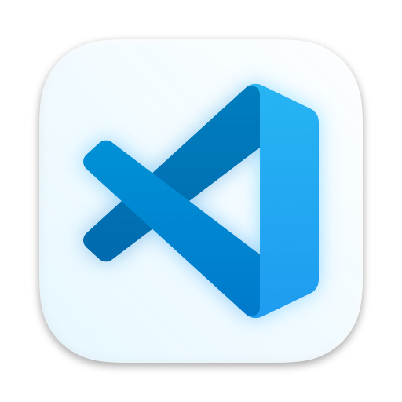

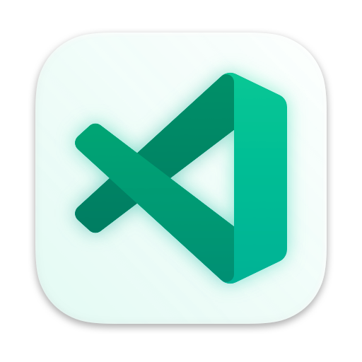


There are also Sketch design files with all the icons. Feel free to use, tweak, add, etc. If you find them useful, a shoutout would be appreciated.

---

David B. Waters

:) :) :)
